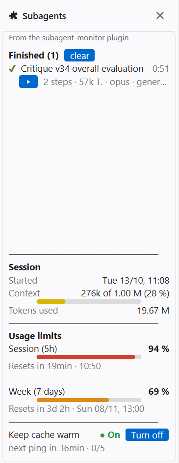
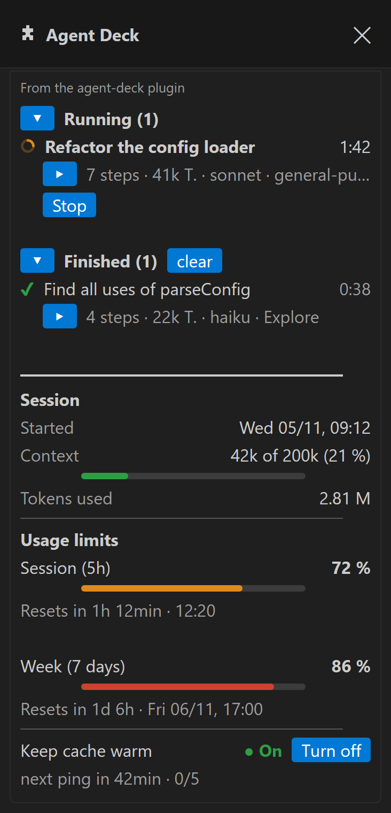

#  Claude Code Agent Deck

[English](README.md) | **Deutsch**

Ein Seitenpanel für [Claude Code](https://claude.com/claude-code), das zeigt, was deine Subagents gerade tun, wie voll der Kontext ist, wie viel von deinen Nutzungslimits übrig ist, und das auf Wunsch den Prompt-Cache warmhält. Von Manuel Hayböck.

**Optimiert für VS Code.** Es läuft auch im Terminal und in der Desktop-App, abgestimmt und geprüft ist das Layout aber in der Claude-Code-Erweiterung für VS Code.

## Installieren

Im Eingabefeld von Claude Code:

```
/plugin install agent-deck --marketplace hayboeck/claude-code-agent-deck
```

Mit `y` die Mod-Sammlung hinzufügen, mit Enter den Bereich „user“ wählen und dann die **Sprache** des Panels: `en` (Englisch, Standard) oder `de` (Deutsch). Die Mod ist sofort aktiv und in jeder neuen Sitzung.

| | |
| --- | --- |
| Panel öffnen | `/agentdeck` (öffnet sich auch von selbst beim ersten Subagent) |
| Aktualisieren | `/plugin update agent-deck`, dann `/reload-plugins` |
| Sprache ändern | `/config`, Zeile *agent-deck › Language*, oder Claude bitten: „stell das Agent Deck auf Deutsch“ |
| Entfernen | `/plugin uninstall agent-deck` |
| Stattdessen aus der Shell | `claude plugin install agent-deck --marketplace hayboeck/claude-code-agent-deck` |

## Was das Panel zeigt

<p>
  
  
</p>

**Subagents.** Ein Eintrag pro Subagent: Aufgabe und Laufzeit (zählt live mit), darunter in einer Zeile Schritte, verbrauchte Tokens (T.), Modell und Typ sowie was er gerade tut (Werkzeug und Ziel: Datei, Befehl, Suchmuster); ist die Zeile zu lang fürs Panel, endet sie mit …. Ein sich drehender orangener Kreis heißt „arbeitet“, ein grünes ✔ „fertig“, ein rotes ✘ „vorzeitig abgebrochen“. **▸** klappt die Liste seiner Schritte auf (die letzten 30), **Stopp**, darunter solange er läuft, hält ihn an, und `leeren` entfernt die fertigen. Der Pfeil vor *Laufend* und *Fertig* klappt den ganzen Abschnitt zu, übrig bleibt die Überschrift mit der Anzahl.

**Sitzung.** Wann dieser Chat begonnen hat, wie voll sein Kontext ist und wie viele Tokens er insgesamt verbraucht hat.

**Nutzungslimits.** Das 5-Stunden- und das Wochenlimit deines Abos, wie Claude Code sie meldet, jeweils mit dem Zeitpunkt des Resets.

**Sprache.** Englisch oder Deutsch, gewählt beim Installieren; eine Änderung lädt das Panel sofort neu.

## Warum diese Farben

| Balken | Grün | Gelb | Orange | Rot |
| --- | --- | --- | --- | --- |
| Session (5h) und Woche | bis 40 % | bis 60 % | bis 80 % | über 80 % |
| Kontext, als Anteil am Fenster des Modells | bis 25 % | bis 50 % | bis 75 % | über 75 % |

- **Limits:** Die Farbe zeigt auf einen Blick, wie sparsam du sein solltest. Grün: frei arbeiten. Gelb und Orange: größere Aufgaben einplanen. Rot: Das Limit ist nah, und die nächste lange Aufgabe passt womöglich nicht mehr hinein.
- **Kontext:** Die Antworten eines Modells werden schlechter, je voller sein Kontext ist, und zwar lange bevor das Fenster voll ist. Es verliert Details vom Anfang des Chats und hält sich weniger verlässlich an frühere Anweisungen. Der Balken wird gelb, wenn das spürbar wird, und rot, wenn es Zeit für `/compact` oder einen neuen Chat ist. Die Mod liest die Fenstergröße des gerade verwendeten Modells aus Claude Code, so passen die Schwellen zu jedem Modell: Bei einem 1M-Fenster liegen sie bei 250k, 500k und 750k Tokens.

## Cache warmhalten

Claude Code hält deinen Chat 60 Minuten nach der letzten Anfrage im Prompt-Cache von Anthropic. Ist der Cache abgelaufen, muss die nächste Nachricht den ganzen Chat neu einlesen. Das kostet viel mehr von deinen Limits als eine Nachricht bei warmem Cache.

**Warum ein Kaltstart so teuer ist.** Eingabe-Tokens kosten nicht alle gleich viel. Nach den API-Preisen von Anthropic, gemessen an einem normalen Eingabe-Token:

| Was mit dem Chat passiert | Preis je Token |
| --- | --- |
| aus dem warmen Cache gelesen | 0,1× |
| neu gelesen und wieder in den Cache geschrieben (Kaltstart, 1-Stunden-Cache) | 2× |

Ein Kaltstart kostet also etwa **20-mal** so viel wie dieselbe Nachricht bei warmem Cache. Bei einem Chat mit 200k Tokens Kontext sind das rund 400k Token-Äquivalente statt 20k, für eine einzige Nachricht, bevor Claude ein Wort geschrieben hat. Wie genau die Abo-Limits diese Tokens zählen, veröffentlicht Anthropic nicht, die Richtung ist aber dieselbe.

Steht es auf **An** (grün angezeigt; rot **Aus** heißt ausgeschaltet; der Knopf daneben sagt *Einschalten* oder *Ausschalten*), wartet die Mod 50 Minuten Ruhe ab und schickt dann eine kurze Nachricht in deinen Chat, in der eingestellten Sprache:

> Cache-Ping von Agent Deck: antworte nur mit OK, keine Werkzeuge.

Claude antwortet mit *OK*. Die Anfrage liest den Chat aus dem Cache, damit beginnen dessen 60 Minuten von vorn. Solange diese Runde läuft, lehnt die Mod jeden Werkzeugaufruf ab, der Ping löst also nie Arbeit aus. Jede echte Nachricht setzt den Countdown ebenfalls zurück.

**Warum eine sichtbare Nachricht und kein unsichtbarer Ping.** Bis Version 0.9 schickte die Mod den Ping unsichtbar, als Nebenanfrage neben dem Chat. Das kann den Cache warmhalten, aber Claude Code sieht eine solche Anfrage nicht: Es zählte den Chat weiter als untätig und zeigte *Prompt cache likely expired (idle 1h 23m)* an. In einem großen Chat (285k Tokens) hatte es außerdem etwa eine Stunde nach der letzten Nachricht im Hintergrund eine Zusammenfassung vorbereitet und den Chat bei der nächsten Nachricht damit kompaktiert; der warme Cache wurde dann gar nicht genutzt. Eine echte Nachricht zählt auch für Claude Code als Aktivität. Der Preis ist ein kurzer Wortwechsel pro Ping in deinem Chat.

- **Höchstens 5 Pings in Folge** (etwa 4 Stunden Ruhe), dann schaltet es sich selbst aus, damit es nie über Nacht läuft.
- **Kosten, gemessen:** Bei einem Chat mit 258k Kontext haben 5 Pings das 5-Stunden-Limit um höchstens einen Prozentpunkt bewegt, das Wochenlimit gar nicht. Aus dem Cache lesen kostet etwa ein Zehntel davon, denselben Text neu zu lesen.
- **Hat es funktioniert?** Die Zeile unter dem Schalter sagt es: *letzter Ping 11:55 · 284k aus dem Cache ✓*. Ein ✗ mit *Cache war kalt* heißt, dass der Cache schon abgelaufen war; *…* heißt, dass der Ping noch wartet, bis Claude mit dem fertig ist, was es gerade tut.
- Lohnt sich, wenn du nach einer Pause weitermachst. Bist du für heute fertig, schalte es aus.

## Kostet die Mod Tokens?

Nein. Die Mod läuft auf deinem Rechner und liest nur, was Claude Code ohnehin meldet: Subagents, Werkzeugaufrufe, Kontextgröße und Limits. Sie fügt deinem Chat und den Anfragen, die Claude schickt, nichts hinzu. Installiert und mit offenem Panel kostet sie also keine Tokens und nichts von deinen Limits.

Die einzige Ausnahme ist **Cache warmhalten**, solange es auf **An** steht: Jeder Ping ist eine echte Nachricht mit kurzer Antwort, und er geht erst nach 50 Minuten raus, in denen du nichts geschrieben hast (Kosten siehe oben). Steht es auf **Aus**, kostet die Mod gar nichts.

## Was die Mod nicht tut

- Sie schickt nichts irgendwohin außer den Pings oben, und die gehen über Claude Code in deinen Chat, an dasselbe Modell.
- Sie speichert nichts auf der Festplatte. Alles, was sie zeigt, lebt in der Sitzung und ist mit ihr weg; die Sprache ist eine normale Plugin-Einstellung.
- Sie ändert nichts an deinen Dateien oder Einstellungen und fügt deinem Chat nichts hinzu außer den Pings, solange **Cache warmhalten** an ist.

## Voraussetzungen

Eine Claude-Code-Version mit Mod-Unterstützung (getestet mit 2.1.318). Die Nutzungslimits erscheinen nur mit einem Claude-Abo (Pro oder Max).

## Lizenz

[MIT](LICENSE): frei verwendbar, veränderbar und weitergebbar, solange der Urheberhinweis erhalten bleibt.

---

## Entwickeln

```
claude plugin validate mods/agent-deck
claude plugin test mods/agent-deck
```

Zum Ausprobieren ohne Installation: `claude --plugin-dir mods/agent-deck`.
