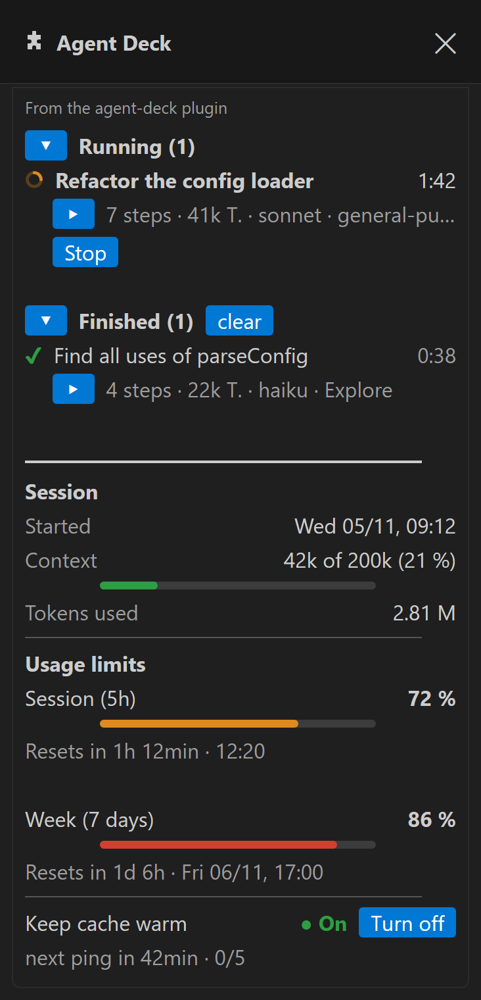

# Claude Code Agent Deck

**English** | [Deutsch](README.de.md)

A side pane for [Claude Code](https://claude.com/claude-code) that shows what your subagents are doing, how full your context is, how much of your usage limits is left, and keeps the prompt cache warm on request. By Manuel Hayböck.

**Optimized for VS Code.** It also runs in the terminal and in the desktop app, but its layout has been tuned and checked in the Claude Code extension for VS Code.

## Install

At the Claude Code prompt:

```
/plugin install agent-deck --marketplace hayboeck/claude-code-agent-deck
```

Answer `y` to add the marketplace, press Enter for the user scope, then pick the **language** of the pane: `en` (English, the default) or `de` (Deutsch). The mod is active at once and in every new session.

| | |
| --- | --- |
| Open the pane | `/agentdeck` (it also opens by itself when the first subagent starts) |
| Update | `/plugin update agent-deck`, then `/reload-plugins` |
| Change the language | `/config`, row *agent-deck › Language*, or ask Claude: "set the Agent Deck language to de" |
| Remove | `/plugin uninstall agent-deck` |
| From a shell instead | `claude plugin install agent-deck --marketplace hayboeck/claude-code-agent-deck` |

## What the pane shows

<p>
  
  
</p>

**Subagents.** One entry per subagent: its task and run time (ticking live), then on one line its steps, tokens used (T.), model and type, and what it is doing right now (the tool and its target: file, command, search pattern); a line too long for the pane ends in …. A turning orange circle means it is working, a green ✔ that it finished, a red ✘ that it stopped early. **▸** folds open the list of its steps (the last 30), **Stop**, on the line below while it runs, ends it, and `clear` removes the finished ones.

**Session.** When this chat started, how full its context is and how many tokens it has used in total.

**Usage limits.** Your subscription's 5-hour and weekly limits as Claude Code reports them, with the time each one resets.

**Language.** English or German, set when you install the mod; a change reloads the pane at once.

## Why the colours

| Bar | Green | Yellow | Orange | Red |
| --- | --- | --- | --- | --- |
| Session (5h) and week | up to 40 % | up to 60 % | up to 80 % | above 80 % |
| Context, as a share of the model's window | up to 25 % | up to 50 % | up to 75 % | above 75 % |

- **Limits:** the colour tells you at a glance how careful to be. Green: work freely. Yellow and orange: plan the larger tasks. Red: the limit is close and the next long task may not fit.
- **Context:** a model's answers get worse as its context fills, well before the window is full. It loses track of details from early in the chat and follows earlier instructions less reliably. The bar turns yellow when that starts to matter and red when it is time for `/compact` or a fresh chat. The mod reads the window size of the model you are using from Claude Code, so the thresholds fit every model: on a 1M window they are 250k, 500k and 750k tokens.

## Keep cache warm

Claude Code keeps your chat in Anthropic's prompt cache for 60 minutes after the last request. When the cache has expired, the next message has to read the whole chat in again, which costs far more of your limits than a message on a warm cache.

**Why a cold start is so expensive.** Input tokens are not all priced the same. By Anthropic's API prices, relative to a normal input token:

| What happens to the chat | Price per token |
| --- | --- |
| read from the warm cache | 0.1× |
| read fresh and written into the cache again (cold start, 1-hour cache) | 2× |

So a cold start costs about **20 times** as much as the same message on a warm cache. On a chat with 200k tokens of context that is about 400k token-equivalents instead of 20k, for one message, before Claude has written a word. Anthropic does not publish exactly how the subscription limits count these, but they follow the same direction.

With the switch **On** (shown in green; red **Off** means switched off; the button beside it says *Turn on* or *Turn off*), the mod waits for 50 minutes of quiet and then sends one invisible ping: the chat as Claude Code last sent it plus the line "Reply only with: OK", with no tools. It does not appear in your chat. Reading the chat from the cache restarts the cache's 60 minutes. Every real message resets the countdown too.

- **At most 5 pings in a row** (about 4 hours of quiet), then it switches itself off, so it never runs all night.
- **Cost, measured:** on a chat with a 258k context, 5 pings moved the 5-hour limit by at most one percentage point, and the weekly limit not at all. A cache read costs about a tenth of reading the same text fresh.
- **Did it work?** The line under the switch says so: *last ping 11:55 · 284k read from cache ✓*. A ✗ with *cache was cold* means the cache had already expired. Claude Code's own note *Prompt cache likely expired (idle 1h 23m)* counts the time since your last message; it does not seem to count the pings, so it can show although the ping above kept the cache warm.
- Worth it when you come back after a break. If you are done for the day, switch it off.

## Does it cost tokens?

No. The mod runs on your machine and only reads what Claude Code reports anyway: subagents, tool calls, context size and limits. It adds nothing to your chat or to the requests Claude sends, so having it installed and the pane open costs no tokens and nothing of your limits.

The one exception is **Keep cache warm** while it is **On**: each ping is a real request, and it is sent only after 50 minutes in which you wrote nothing (see the cost above). Switched **Off**, the mod costs nothing at all.

## What it does not do

- It sends nothing anywhere except the pings above, and those go through Claude Code to the same model.
- It stores nothing on disk. Everything it shows lives in the session and is gone when it ends; the language is a normal plugin setting.
- It changes nothing in your chat, your files or your settings.

## Requirements

A Claude Code version with mod support (tested with 2.1.318). The limits section shows only with a Claude subscription (Pro or Max).

## License

[MIT](LICENSE): free to use, change and share, as long as the copyright notice stays in.

---

## Develop

```
claude plugin validate mods/agent-deck
claude plugin test mods/agent-deck
```

To try it without installing it: `claude --plugin-dir mods/agent-deck`.
